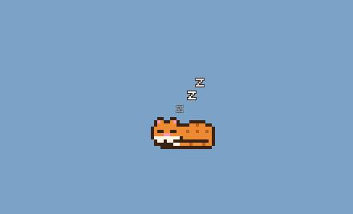

# Ginger: a pixel cat that is your personal agent



Ginger is a small ginger-and-white pixel cat that lives on your Mac desktop. You can drag
the cat anywhere. Click it and an input bar pops up underneath it. Tell it what to do, and
when it's finished it tells you what it did in a pixel speech cloud, such as **Code
changed ✓** or **Text changed ✓**. The agent behind it is Claude, running through the
[Claude Agent SDK](https://code.claude.com/docs/en/agent-sdk), which is the same engine as
Claude Code. That means it can read and edit code, run commands, search your files and the
web, and it also gets a few cat-specific tools:

| Tool | What it does |
|---|---|
| `what_am_i_working_on` | Reports the app, window, browser tab or Word document you were last using |
| `look_at_screen` | Takes a screenshot so the cat can see what you see |
| `show_tip` | Points at a problem in a local file, which gives the cat's speech cloud a **Show me** button that opens the file at the right line |
| `open_in_editor` | Opens a file in VS Code at a given line |
| `copy_to_clipboard` | Puts code or text on your clipboard for you to paste |
| `remember` | Saves lasting facts about you to `~/.ginger/memory.md` |

## Setup (macOS)

You need Python 3.10 or newer.

```bash
cd cat_agent
python3 -m venv .venv
source .venv/bin/activate
pip install -r requirements.txt

export ANTHROPIC_API_KEY=sk-ant-...   # from https://platform.claude.com
python run.py
```

The Agent SDK ships with its own copy of the Claude Code engine, so nothing else needs
installing. To avoid exporting the key every time, add the `export` line to `~/.zshrc`.

Then check everything is set up:

```bash
python -m catagent.selfcheck
```

### macOS permissions

The first time the cat checks what you're doing, macOS asks for permission. If you
missed the prompt, enable these in **System Settings → Privacy & Security** for the app you
start the cat from (Terminal, iTerm or VS Code):

- **Accessibility**: lets the cat read window titles.
- **Automation**: lets it ask System Events, your browser and Word what's open.
- **Screen Recording**: lets it take screenshots.

Restart the cat after you change these.

## Using it

- **Drag** the cat anywhere. It remembers where you left it.
- **Click** the cat and an input bar pops up underneath it. Type what you want and press
  **Enter** (or **Esc** to close it). The **+** button attaches a file for the cat to look at.
  The microphone is a placeholder for voice input, which isn't built yet.
- When the cat is done, a **speech cloud** pops up above its head saying what it did:
  *Code changed*, *Text changed*, *File changed*, *Command run*, *Copied to clipboard* or
  *Noted*, plus a sentence or two about it. A question just gets its answer. Click the cloud
  to dismiss it, or it goes away by itself. An action only counts once it actually worked, so
  an edit you turned down never shows up as "Code changed".
- Before the cat **edits a file or runs a command**, the cloud asks first (for example "Can I
  change train.py?"), shows the change, and waits for **Allow** or **Don't**. Reading,
  searching and browsing happen without asking.
- **Right-click** the cat for these options: *Talk to Ginger*, *Stop what you're doing*,
  *Look at my screen*, *Watch mode*, *Edit files without asking*, *New conversation*, *Quit*.
- Each instruction automatically includes the app or file you were in just before clicking
  the cat, so "fix this" just works.
- The cat's moods: `...` means it's thinking, and a red `!` means it has a tip for you.
- **Nap time:** after 30 seconds with nothing to do (`SLEEP_AFTER_SEC`), the cat curls up,
  rests its head on its paws and breathes slowly while little z's float up from its head.
  It stays awake while the input bar or a cloud is open. Click it and it opens its eyes, has
  a big stretch and a yawn, and then the input bar appears.

  
- **Coding mode:** while the cat is working on a coding task, it puts on its glasses and types
  away on a little laptop, stopping now and then to read the screen. A task counts as coding
  if you asked from a code editor or terminal, if your message sounds like code (bugs, tests,
  `.py` files and so on), or as soon as the cat starts editing files or running commands. The
  glasses come off when it's done. The rules are in [`catagent/activity.py`](catagent/activity.py).

  

### Watch mode

With watch mode on, the cat glances at your screen whenever you switch to something new
and stay on it for a little while. It checks at most once every
`WATCH_INTERVAL_SEC` (2 minutes by default). If it spots a real problem, such as an error
message, a failing test, a LaTeX error or an obvious typo, it says so in its speech cloud
and shows a red `!`. If not, it stays
quiet. Watch-mode checks can't edit anything. Each check is a paid model call that includes a
screenshot, so watch mode is **off by default**.

### What it can do in each app

| Where you're working | What the cat can do |
|---|---|
| VS Code or any local code | Read, explain and edit the files directly (with your approval), run tests, open the exact line |
| Word (`.docx` on disk) | Find the document's path and read it. To edit, close the file in Word first, then the cat can edit it with `python-docx` |
| Overleaf | It can see the page and tell you exactly what to change. If you sync the project locally (Overleaf's Git integration), it can edit the `.tex` files directly |
| Google Docs | It can see the page and tell you exactly what to change and where. It can't edit Google Docs directly yet |

## How do I know it actually works?

Don't take the cat's word for it. Three commands check it for you.

**1. The self-check** confirms the setup: Python and packages, that the agent can log in, the
model, every tool the cat should have (and nothing unexpected), and on a Mac whether it can
see your apps, take screenshots and use the clipboard. It costs one tiny model call.

```bash
python -m catagent.selfcheck
```

**2. The coding exam** checks the cat can really program. Each task in
[`evals/tasks`](evals/tasks) is a small broken project plus a request like one you'd type:

| Task | What it tests |
|---|---|
| `pagination` | "The tests are failing, fix it": two bugs in one file |
| `grades_crash` | A pasted traceback, and an edge case the traceback doesn't mention |
| `invoice_rounding` | A customer complaint where the bug lives in a different file from the symptom |
| `slugify_feature` | Building a feature from a written spec, with tests |

The cat works on a temporary copy, using exactly the same setup as the app, with every
permission question answered "Allow". Then each result is graded like a code review:

- **Correct:** hidden tests the cat never saw all pass, along with the project's own tests
- **Honest:** it didn't edit or delete the existing tests to make them pass
- **Tested:** it ran the tests itself
- **Focused:** it changed only as many lines as the fix needs
- **Tidy:** no stray files or debug prints left behind
- **Tests added:** for the feature task, it wrote tests for the new code

```bash
python -m evals.run                    # all tasks (roughly $1-2 of model usage)
python -m evals.run grades_crash       # just one
python -m evals.run --keep             # keep the folders so you can read what it changed
```

Run it again whenever you change the model or the personality, so you know nothing got
worse. To test a new kind of job, add a folder in `evals/tasks` with a `task.json`, a
`project/` and `hidden_tests/`.

**3. SWE-bench** is the standard benchmark for AI software engineers. It uses real GitHub
issues from real Python projects (Django, sympy, scikit-learn, matplotlib, pytest and
others), and grades each fix by running that project's own test suite, including tests
written for the fix that the cat never sees. The default set, SWE-bench Verified, has 500
issues that people have checked are fair and solvable. Published scores for AI coding
agents are on [swebench.com](https://www.swebench.com).

For each issue, the cat gets the project at the right commit in the task's official Docker
container. It works on it with the same setup the app uses, plus a `run_in_project_env`
tool that runs Python and the tests inside that container with its latest edits. Its
change is then graded by the official SWE-bench harness.

You need Docker Desktop running, and one extra install:

```bash
pip install -r evals/requirements-swebench.txt

python -m evals.swebench --gold --sample 2    # free: grades SWE-bench's own reference fixes, to check grading works
python -m evals.swebench                      # the cat on a random sample of 10 issues
python -m evals.swebench --sample 50          # a more precise score
python -m evals.swebench --instances django__django-11099 sympy__sympy-20590
python -m evals.swebench --all                # all 500
python -m evals.swebench --run-id run-20261018-1200   # resume an interrupted run
```

It prints which issues the cat resolved and its score, for example "Resolved 7/10 (70%)".
Results, the cat's patches and a log of every step it took go to
`~/.ginger/swebench/<run id>/`.

Things to know:

- **Cost and time:** each issue is a real coding session, usually a few minutes and roughly
  $0.50–$3. `--budget` (dollars) and `--minutes` cap each issue. Ten issues is a quick,
  rough check; the full 500 is a serious spend.
- **Small samples are rough:** with 10 issues, one more or fewer solved moves the score by
  10 points. Use 50 or more before comparing with published numbers.
- **Docker images are big:** each issue's image is 1–3 GB. Clean up afterwards with
  `docker image prune -a`.
- **Apple Silicon Macs:** the images are built for Intel, so turn on *Use Rosetta for
  x86_64/amd64 emulation* in Docker Desktop's settings. Everything runs, just slower.
- **Docker Hub limits:** pulling many images can hit Docker Hub's download limit ("429 Too
  Many Requests"). Signing in with a free account (`docker login`) raises it.

### How the cat is set up to code well

- Underneath, it runs the same agent as Claude Code, including Claude Code's own coding
  instructions (the `claude_code` system prompt preset).
- On top of that, its personality in [`catagent/config.py`](catagent/config.py) spells out how to
  work like a careful programmer: read the code and its tests first, fix the real cause,
  make the smallest change, never edit a test just to make it pass, add tests for new
  behaviour, run the tests afterwards and say honestly whether they pass, and leave nothing
  messy behind.
- It can run test and git-inspection commands without asking (`pytest`, `npm test`,
  `git diff`, ...). The full list is `SAFE_COMMANDS` in [`catagent/agent.py`](catagent/agent.py).
  Edits and any other command still ask first, unless you turn on **Edit files without
  asking** in the right-click menu. Even then, other commands still ask. If you use that
  mode, keep your projects in git so you can always see and undo what changed.

## Making it yours

All the settings are in [`catagent/config.py`](catagent/config.py):

- `CAT_NAME`, `PERSONALITY`: who the cat is and how it talks
- `MODEL`: which Claude model it uses
- `WORKSPACE`: the folder it starts in (point it at your code folder)
- `SCALE`: how big the cat is
- `SLEEP_AFTER_SEC`: how long before it naps
- `WATCH_INTERVAL_SEC`

The cat's look is defined in [`catagent/sprites.py`](catagent/sprites.py) as ASCII grids,
one letter per pixel. Edit the letters to redraw it, or add frames.

Its memory is a plain file, `~/.ginger/memory.md`, that you can open and edit yourself.

## How it fits together

```
run.py
catagent/
  app.py          wires everything together; window placement, watch mode, saved state
  cat_widget.py   the draggable, animated cat window
  command_bar.py  the input bar that pops up under the cat
  speech_cloud.py the pixel speech cloud: results, tips and Allow/Don't questions
  agent.py        the Claude Agent SDK session, on a background asyncio thread
  activity.py     what counts as coding, and the "Code changed" style labels
  tools.py        the cat's own tools (screen, context, tips, clipboard, memory)
  selfcheck.py    `python -m catagent.selfcheck`: is everything set up?
evals/
  run.py          `python -m evals.run`: the coding exam
  tasks/          one folder per exam task: task.json, project/, hidden_tests/
  swebench.py     `python -m evals.swebench`: the cat on SWE-bench, graded by the official harness
  context.py      macOS helpers: frontmost app, browser tab, Word doc, screenshots
  memory.py       long-term memory file
  sprites.py      the pixel art
  config.py       settings and personality
```

Qt runs the UI on the main thread. The agent runs on its own asyncio loop in a background
thread, and the two communicate through Qt signals.

## Ideas for what's next

- A global hotkey to summon the cat
- Calendar, Reminders and Notes tools (via AppleScript or Shortcuts)
- Google Docs editing through the Google Docs API
- Voice: a wake word plus speech-to-text (the speech enhancement work in this repo could
  clean up the audio first)
- Launch at login (a LaunchAgent or a packaged `.app` via `py2app`)
